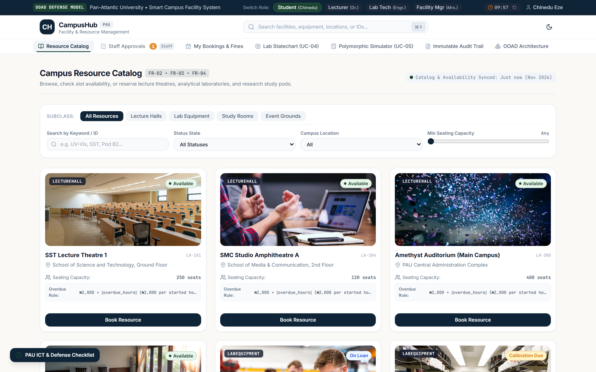
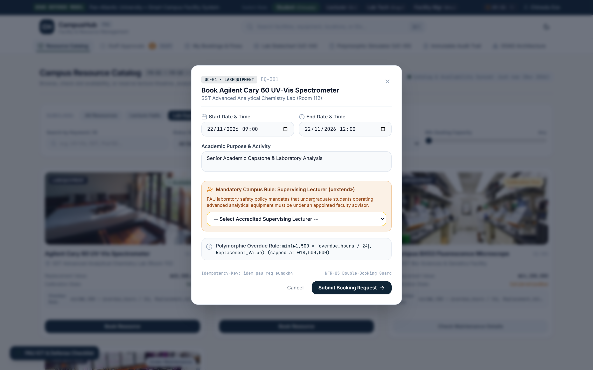
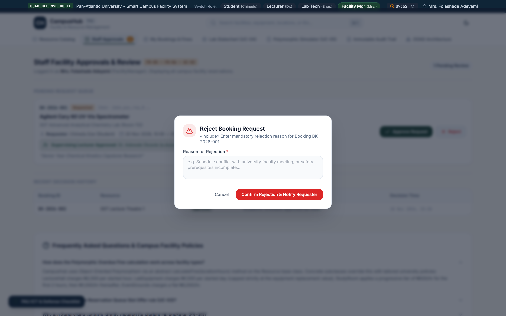
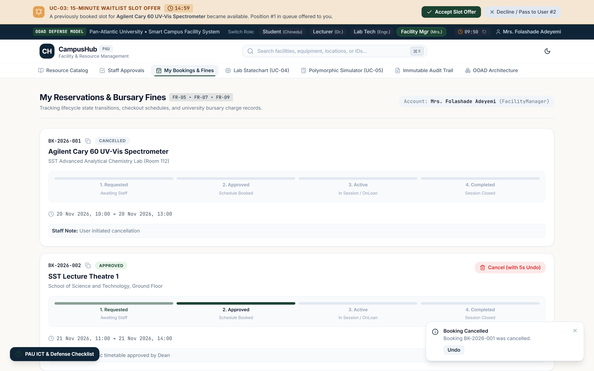
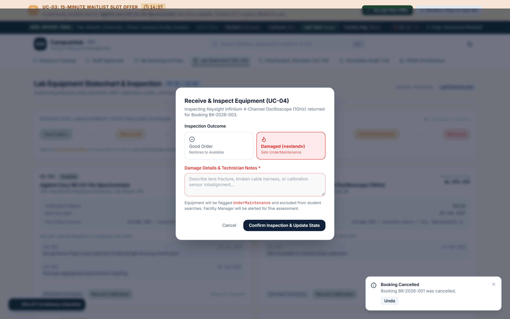
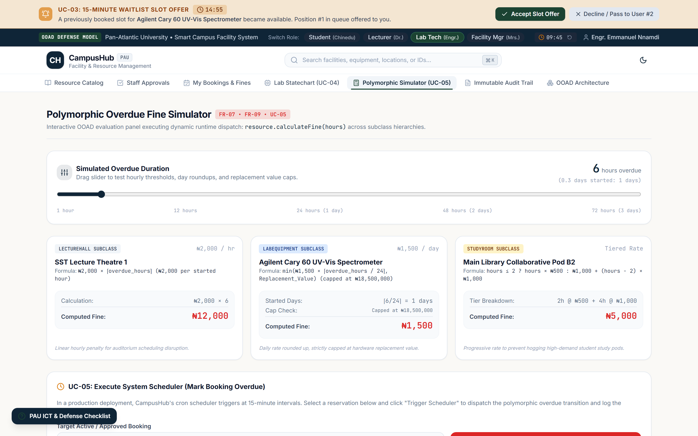
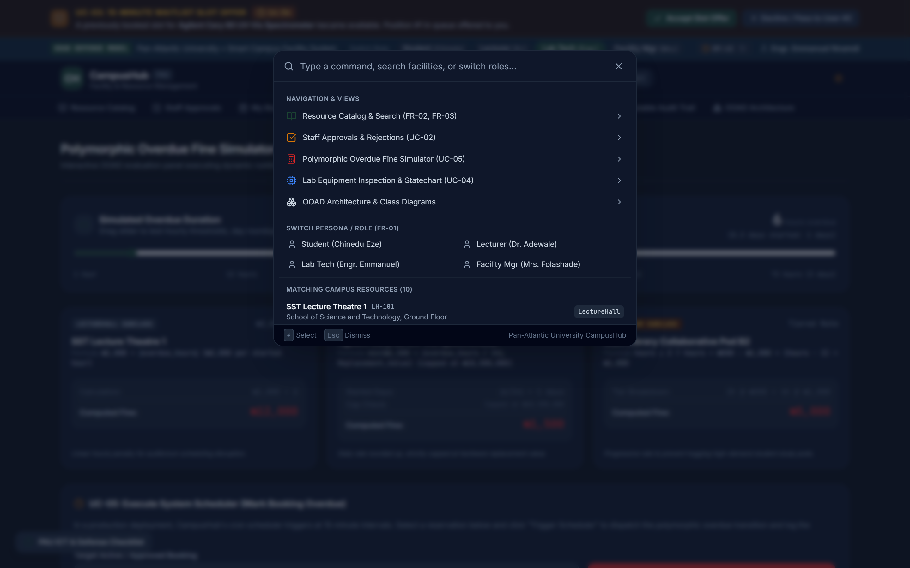
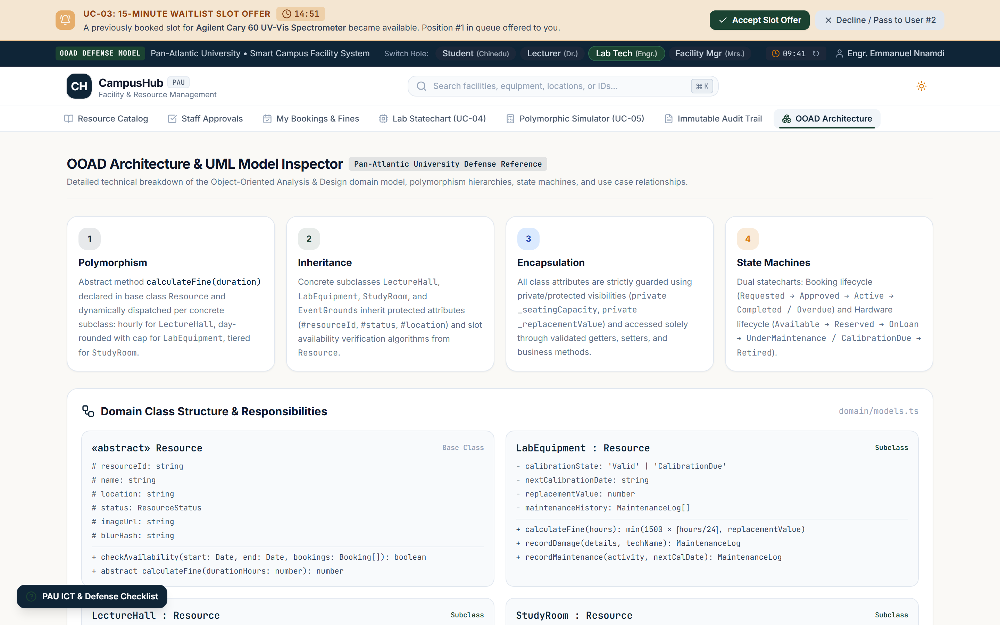

# CampusHub: Smart Campus Facility & Resource Management System
## Phase 4 OOAD Defense Walkthrough & High-Resolution Screenshots
**Pan-Atlantic University (PAU) &bull; Department of Computer Science & Software Engineering**

---

### Screenshot Gallery & Requirement Verification

#### 1. Resource Catalog & Role-Based Access Control (FR-01, FR-02, FR-03)

- **Top Defense Walkthrough Bar:** Instant 1-click switcher between *Student* (Chinedu Eze), *Lecturer* (Dr. Adewale Olusola), *Lab Technician* (Engr. Emmanuel Nnamdi), and *Facility Manager* (Mrs. Folashade Adeyemi).
- **Session Timer:** 10-minute session inactivity countdown indicator with reset capability.
- **Search & Filters:** Real-time filtering (<150ms) across subclasses (`LectureHall`, `LabEquipment`, `StudyRoom`, `EventGrounds`), minimum capacity slider, locations, and availability states.
- **Concentric Design:** Concentric card hierarchy ($R_{outer} = R_{inner} + P$), CSS blurred placeholder transitions, and Swiss minimalist aesthetic.

---

#### 2. UC-01: Booking Verification & Supervising Lecturer Rule (FR-04, UC-01)

- **Supervising Lecturer Rule (`«extend»`):** When a Student reserves `LabEquipment` (e.g., Agilent Cary 60 UV-Vis Spectrometer), the system dynamically enforces selection of an accredited Supervising Lecturer.
- **Idempotency Key:** Visible client-side token (`Idempotency-Key: idem_pau_req_...`) in the booking form footer to demonstrate double-booking prevention (NFR-05).
- **Overlap Prevention:** Strictly verifies slot conflicts and blocks unavailable/under-maintenance items.

---

#### 3. UC-02: Staff Review & Mandatory Rejection Reason (FR-06, UC-02)

- **Staff Approval Queue:** Facility Manager and Lab Technicians inspect pending requests with full requester context and lecture supervisor credentials.
- **Mandatory Rejection (`«include»`):** Rejection modal requiring mandatory reason entry before transitioning state to `Cancelled` and writing to the audit log.

---

#### 4. UC-03: Reservation Queue & 15-Minute Slot Offer (FR-08, UC-03)

- **Waitlist Queue:** Automatic position tracking (`#1`, `#2`) for contested slots.
- **Ticking Slot Offer Banner:** Upon cancellation of an active slot, User #1 receives an urgent 15-minute countdown banner (`14:59`) with direct **Accept Slot Offer** or **Decline / Pass to User #2** controls.

---

#### 5. UC-04: Lab Equipment Statechart & Inspection (FR-10, UC-04)

- **UML Statechart Pattern:** Interactive lifecycle states: `Available` $\rightarrow$ `Reserved` $\rightarrow$ `OnLoan` $\rightarrow$ `UnderMaintenance` / `CalibrationDue` $\rightarrow$ `Retired`.
- **Receive & Inspect Equipment:** Returns in Good Order restore hardware to `Available`; Damage reports (`«extend» Log equipment damage`) transition hardware to `UnderMaintenance` and flag damage assessment.
- **Calibration Cycle:** Simulation of calibration expiration and recording of NIST calibration renewals.

---

#### 6. UC-05: Polymorphic Overdue Fine Simulator (FR-09, UC-05)

- **Dynamic Runtime Dispatch:** Evaluates `resource.calculateFine(durationHours)` across subclasses:
  - `LectureHall`: ₦2,000 per started hour (linear hourly penalty).
  - `LabEquipment`: ₦1,500 per started day (day-rounded, capped at hardware replacement value).
  - `StudyRoom`: Progressive tier (₦500/hr for first 2 hrs, ₦1,000/hr thereafter).
  - `EventGrounds`: ₦5,000 flat per started hour.
- **Scheduler Trigger:** One-click simulation of the background cron scheduler transitioning an active booking to `Overdue` and assessing a Bursary fine reference (`FN-2026-...`).

---

#### 7. Command Palette & Dark Mode (Global Shortcuts)

- **Global Command Menu (`⌘K` / `Ctrl+K`):** Global keyboard navigation for switching roles, jumping between views, and quick search.
- **Academic Dark Palette:** Obsidian Slate (`#0B0F17`) background with Forest Emerald accents.

---

#### 8. Immutable Audit Trail & OOAD Architecture Inspector (NFR-07)

- **NFR-07 Audit Trail:** Tamper-evident, append-only chronological log recording actors, timestamps, action IDs, and booking tokens.
- **OOAD Architecture:** Detailed class hierarchy, encapsulation boundaries, polymorphism analysis, and formal use case mappings.
